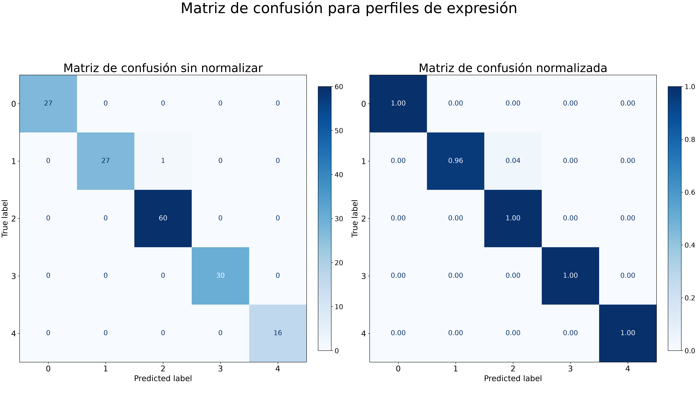

```{python set_up}
#| echo: true
#| eval: false
#| warning: false

import pandas as pd

import torch
from torch import nn
from torch.utils.data import Dataset, DataLoader

from sklearn.model_selection import train_test_split

from torchvision import datasets
from torchvision.transforms import ToTensor

import numpy as np
from sklearn.metrics import f1_score, precision_score, recall_score, roc_auc_score
from sklearn.metrics import (
    ConfusionMatrixDisplay,
    confusion_matrix,
    classification_report,
)
import matplotlib.pyplot as plt
``` 


# Carga de Datos y preprocesamiento

## Lectura de datos y exploración inicial
```{python lectura}
#| echo: true
#| eval: false
#| warning: false

#leer los data sets
df_data= pd.read_csv("/mnt/c/Users/vrahu/Documents/Ismadlsh/CCG/2026-S5/Data_Science/data/perfiles.csv", index_col=0).rename_axis(None)

df_cathegories= pd.read_csv("/mnt/c/Users/vrahu/Documents/Ismadlsh/CCG/2026-S5/Data_Science/data/categorias_perfiles.csv", index_col=0).rename_axis(None)

#unir los data sets por el index
df_data=pd.merge(df_data, df_cathegories, left_index=True, right_index=True)
print("Dimensionalidad de datos:", df_data.shape)
class_u=df_cathegories.Categoria.unique()
print("Categorías verdaderas únicas:", class_u)
df_data.head()
``` 

Se observo que el dataset contiene 20531 genes y 5 categorías de perfiles de expresión. Por ende los perfiles de expresión se tomaron como variables yua numericas mientras que las categorías el cual es la variable a predecir se deben transformar conserbando la información.


### Categorias a numerico 

```{python class_dic}
#| echo: true
#| eval: false
#| warning: false

cat_ids={cat_u: i for i, cat_u in enumerate(class_u)}

ids_cat={cat[1]:cat[0] for cat in cat_ids.items()}

``` 


## Split de los datos 

Consiguientemente se dividieron los datos en un 80% para entrenamiento y un 20% para prueba, estratificando por la variable de categoría para mantener la proporción de clases en ambos conjuntos.

```{python data_split}
#| echo: true
#| eval: false
#| warning: false


df_train, df_test = train_test_split(df_data, test_size=0.2, random_state=42, stratify=df_data.Categoria)

print("Dimensionalidad de datos de entrenamiento:", df_train.shape)
print("Dimensionalidad de datos de prueba:", df_test.shape)
``` 

# Modelado 

## Creación data set 

```{python data_set_class}
#| echo: true
#| eval: false
#| warning: false

# Definición de la clase a partir del módulo Dataset de PyTorch
class PerfilesDataset(Dataset):
    def __init__(self, dataframe):
        # Definimos dos atributos de la clase:
        # - El DataFrame de donde crearemos el DataSet
        self.data = dataframe
        # - El número de registros del DataSet
        self.len = len(dataframe)

    def __getitem__(self, index):
        # El argumento "index" es un índice numérico desde 0 hasta el último registro el DataFrame

        # Guardamos en una variable el perfil de expresión separado de la categoría
        # El procedimiento "drop" con "axis = 1" elimina una columna del DataFrame
        # El procedimiento "iloc" localiza y entrega el registro "index" del DataFrame
        perfil_de_expresion = self.data.drop(["Categoria"], axis=1).iloc[index].values
        # Guardamos en una variable la categoría separada del perfil de expresión
        categoria = self.data.Categoria.iloc[index]

        # Convertimos la categoría en id con nuestro diccionario
        encoded_categoria = cat_ids[categoria]

        # Convertimos variables con el perfil y la categoría en tensores de PyTorch
        tensor_perfil_de_expresion = torch.as_tensor(perfil_de_expresion)
        tensor_categoria = torch.as_tensor(encoded_categoria)
        return tensor_perfil_de_expresion, tensor_categoria

    def __len__(self):
        # Procedimiento obligatorio para regresar el número de renglones del DataSet
        return self.len

#asignar los datasets al objeto creado en la clase 
dataset_train = PerfilesDataset(dataframe=df_train)
dataset_test = PerfilesDataset(dataframe=df_test)
``` 

### Dataloader

```{python data_sets_obj}
#| echo: true
#| eval: false
#| warning: false

#seleccionar el tamaño de lote 
batch_size = 8

#crear los data loaders 
dataloader_train = DataLoader(dataset_train, batch_size=batch_size, shuffle=True)
dataloader_test = DataLoader(dataset_test, batch_size=batch_size, shuffle=False)
``` 


## Arquitectura de la red neuronal

```{python device}
#| echo: true
#| eval: false
#| warning: false

if torch.cuda.is_available():
    device = "cuda"
else:
    device = "cpu"
print("Device disponible para entrenamiento:", device)


class MLP(nn.Module):
    def __init__(self):
        super().__init__()
        self.capas = nn.Sequential(
            nn.Linear(20531, 256),
            nn.ReLU(),
            nn.Linear(256, 512),
            nn.ReLU(),
            nn.Linear(512, 256),
            nn.ReLU(),
            nn.Linear(256, 5),
        )
        self.double()

    def forward(self, x):
        logits = self.capas(x)
        return logits


# chargue to device
red_mlp = MLP().to(device)
print(red_mlp)
``` 


## Entrenamiento y evaluación de la red neuronal

### Hiperparámetros funciones

Como parte de la arquitectura de la red se usaron la función de perdida por cruce de entropía y el optimizador Adam con una tasa de aprendizaje de 0.0001.

```{python device}
#| echo: true
#| eval: false
#| warning: false

funcion_de_perdida = nn.CrossEntropyLoss()
optimizador_de_pesos = torch.optim.Adam(red_mlp.parameters(), lr=0.0001)
``` 

### Función de entrenamiento

```{python device}
#| echo: true
#| eval: false
#| warning: false

def train(dataloader, red, funcion_perdida, optimizador):
    total_de_registros = len(dataloader.dataset)
    # Activamos nuestra red en modo de entrenamiento
    red.train()

    # Para cada batch de datos y categorías:
    for lote, (X, y) in enumerate(dataloader):
        # Enviamos datos y categorías al device
        X, y = X.to(device), y.to(device)
        # Obtenemos predicciones de la red (logits) para el conjunto de datos del lote (forward)
        logits = red(X)
        # Obtenemos valor de función de pérdida
        valor_de_perdida = funcion_perdida(logits, y)
        # Backpropagation
        valor_de_perdida.backward()
        # Modificación (ajuste) de pesos
        optimizador.step()
        # Reseteo de gradientes para evitar acumulación
        optimizador.zero_grad()

        # Cada 5 batches
        if lote % 5 == 0:
            print("Lote número:", lote)
            # Calculamos registros procesados multiplicando el número de lote (`lote`) por la cantidad de registros del lote (`X`)
            registros_procesados = (lote + 1) * len(X)
            # item() regresa el valor del tensor en tipo numérico de Python
            print("Valor de función de pérdida:", valor_de_perdida.item(), "Lote:", lote, "Registros:[", registros_procesados, "/", total_de_registros, "]")
```

### Función de evaluación

```{python device}
#| echo: true
#| eval: false
#| warning: false

def test(dataloader, red, funcion_perdida):
    total_de_registros = len(dataloader.dataset)
    # Obtenemos el número de lotes de los datos de prueba
    numero_de_lotes = len(dataloader)
    # Activamos nuestra red en modo de prueba
    red.eval()

    # Inicializamos valor de función de pérdida y número de predicciones correctas
    valor_de_perdida_acumulado = 0
    predicciones_correctas_acumuladas = 0

    lista_cat_predichas = []
    lista_cat_verdaderas = []
    # Desactivamos los cálculos de gradientes porque no estamos en fase de entrenamiento
    with torch.no_grad():
        # Para cada conjunto de datos y categorías del lote:
        for X, y in dataloader:
            # Enviamos datos y categorías al device
            X, y = X.to(device), y.to(device)
            # Obtenemos predicciones de la red (logits) para el conjunto de datos del lote
            logits = red(X)

            cat_predichas = torch.argmax(logits, dim=1)
            # Obtenemos el valor de la función de pérdida acumulado y predicciones correctas acumuladas
            valor_de_perdida = funcion_de_perdida(logits, y).item()
            valor_de_perdida_acumulado = valor_de_perdida_acumulado + valor_de_perdida
            # Obtenemos predicciones correctas (True|False) comparando el índice del valor máximo de los logits con la categoría verdadera
            # argmax(1) regresa el índice del valor máximo en el tensor.
            predicciones_correctas = logits.argmax(1) == y
            # Convertimos predicciones correctas en números
            predicciones_correctas = predicciones_correctas.type(torch.float)
            # Sumamos predicciones correctas
            predicciones_correctas = predicciones_correctas.sum().item()
            # Obtenemos predicciones correctas acumuladas
            predicciones_correctas_acumuladas = (
                predicciones_correctas_acumuladas + predicciones_correctas
            )
            # Juntamos en listas de forma acumulada las categorías predichas y las categorías verdaderas
            lista_cat_predichas.extend(cat_predichas.tolist())
            lista_cat_verdaderas.extend(y.tolist())
    # test_loss /= num_batche
    # correct /= size
    accuracy = predicciones_correctas_acumuladas / total_de_registros
    print("Accuracy:", accuracy)
    # print(f"Fase de prueba: \n Accuracy: {(100*correct):>0.1f}%, Avg loss: {test_loss:>8f} \n")
    return accuracy, lista_cat_predichas, lista_cat_verdaderas
```

### Run

Para la run se no se utilizo un numero de épocas fijo, sino que se estableció un criterio de convergencia basado en la diferencia de accuracy entre épocas consecutivas. Si la diferencia es menor a 0.0000001 durante 3 épocas consecutivas, se considera que el modelo ha convergido y se detiene el entrenamiento.

```{python device}
#| echo: true
#| eval: false
#| warning: false

err = 0.0000001
conver = 0
accuracy_b = 0
while conver < 3:
    print("\nEntrenamiento\n-------------------------------")
    train(dataloader_train, red_mlp, funcion_de_perdida, optimizador_de_pesos)
    print("\nPrueba\n-------------------------------")
    accuracy, cat_pred, cat_true = test(dataloader_test, red_mlp, funcion_de_perdida)
    if abs(accuracy - accuracy_b) < err:
        conver += 1
    accuracy_b = accuracy
``` 

Durante la fase de entrenamiento se obtuvo un valor convergente de accuracy de 0.9937888198757764 en un total de 15 epocas.

# Resultados

## Metricas redimiento

```{python device}
#| echo: true
#| eval: false
#| warning: false

# Obtenemos metricas de evaluación comparando las categorías predichas con las categorías verdaderas
print("F1-score: %0.2f" % f1_score(cat_true, cat_pred, average='macro'))
print("Precision: %0.2f" % precision_score(cat_true, cat_pred, average='macro'))
print("Recall: %0.2f" % recall_score(cat_true, cat_pred, average='macro'))
print("Reporte de clasificación")
# Obtenemos reporte de clasificación
print(classification_report(cat_true, cat_pred, output_dict=True))

#creamos el df con los valores 
report_dic=classification_report(cat_true, cat_pred, output_dict=True)
df_report=pd.DataFrame(report_dic).transpose()
```

| Class | precision | recall | f1-score | support |
|:-----:|----------:|-------:|---------:|--------:|
| 0 | 1.000000 | 1.000000 | 1.000000 | 27.000000 |
| 1 | 1.000000 | 0.964286 | 0.981818 | 28.000000 |
| 2 | 0.983607 | 1.000000 | 0.991736 | 60.000000 |
| 3 | 1.000000 | 1.000000 | 1.000000 | 30.000000 |
| 4 | 1.000000 | 1.000000 | 1.000000 | 16.000000 |
| macro avg | 0.996721 | 0.992857 | 0.994711 | 161.000000 |
| weighted avg | 0.993891 | 0.993789 | 0.993758 | 161.000000 |

Se obtuvieron las matricas de precisión, recall y f1-score para cada clase, así como el promedio macro y ponderado. Como ya lo sugería el accuracy obtenido en el entrnamiento el desempeño en las metricas es muy elevado teniendo capacidad de predicción practicamente perfecta para 3 de las clases y para las otras dos clases se intuye que la presición baja de la clase 2 se debe a aquellas que esta prediciendo como las clase 1 y por ende el recall de la clase 1 es menor a 1.0.

## Matrices de confusión

```{python device}
#| echo: true
#| eval: false
#| warning: false

conf_mat, axes = plt.subplots(1, 2, figsize=(20, 10), layout="constrained")

matrix_confusion = confusion_matrix(cat_true, cat_pred)
disp1 = ConfusionMatrixDisplay(confusion_matrix=matrix_confusion)
disp1.plot(cmap=plt.cm.Blues, ax=axes[0], colorbar=False, text_kw={"fontsize": 14})
axes[0].set_title("Matriz de confusión sin normalizar", fontsize=24)
axes[0].tick_params(axis="x", labelsize=16)
axes[0].tick_params(axis="y", labelsize=16)
axes[0].xaxis.label.set_size(16)
axes[0].yaxis.label.set_size(16)

# Crear y ajustar la barra de color
cbar1 = conf_mat.colorbar(disp1.im_, ax=axes[0], fraction=0.046, pad=0.04)
cbar1.ax.tick_params(labelsize=14)  # Tamaño de los números de la leyenda


matrix_confusion_norm = confusion_matrix(cat_true, cat_pred, normalize="true")
disp2 = ConfusionMatrixDisplay(confusion_matrix=matrix_confusion_norm)
disp2.plot(
    cmap=plt.cm.Blues,
    ax=axes[1],
    values_format=".2f",
    colorbar=False,
    text_kw={"fontsize": 14},
)
axes[1].tick_params(axis="x", labelsize=16)
axes[1].tick_params(axis="y", labelsize=16)
axes[1].set_title("Matriz de confusión normalizada", fontsize=24)
axes[1].xaxis.label.set_size(16)
axes[1].yaxis.label.set_size(16)

cbar2 = conf_mat.colorbar(disp2.im_, ax=axes[1], fraction=0.046, pad=0.04)
cbar2.ax.tick_params(labelsize=14)

conf_mat.suptitle("Matriz de confusión para perfiles de expresión", fontsize=30)

conf_mat.set_size_inches(20, 12)
conf_mat.savefig(
    "/mnt/c/Users/vrahu/Documents/Ismadlsh/CCG/2026-S5/Data_Science/res/NN/confusion_matrix_profiles_MLP.png",
    dpi=300,
)
plt.show()
``` 

{#fig-aligned-vs-time fig-pos="H" width="85%" fig-align="center"} 

La matriz de confusión exiende de forma comprobatoria las asumciones de las metricas antes presentadas, ya que la categoria numero 1 esta siendo confundida con la categoria numero 2, mientras que las otras categorias no presentan confusión alguna. Esto sugiere que son perfiles de expresión más similares entre ambos tipos de cancer y que los demas cuentan con factores muy diferentes en los mismos, lo que los hacen más distinguibles.