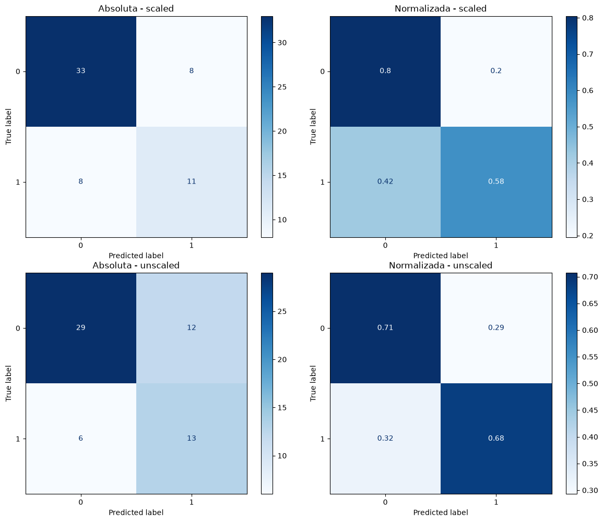

# Arboles de desición

Los árboles de decisión son un modelo de aprendizaje supervisado que se utiliza para clasificación y regresión. Se construyen dividiendo el conjunto de datos en subconjuntos basados en características.

Para ello, el algoritmo sigue una serie de pasos iterativos en los cuales se selecciona una característica de manera aleatoria o basada en una métrica, como la maximización de la entropía. Posteriormente, se establece un criterio de división basado en esta característica para dividir el conjunto de datos en dos subconjuntos, que son evaluados en función de la característica de interés. Este proceso se repite iterativamente con cada característica seleccionada por el modelo hasta que todas estén clasificadas.

Esto hace de la fase de entrenamiento un proceso en el que los hiperparámetros y los datos de entrada juegan un papel importante. En esta práctica se hará la comparación entre dos tipos de entradas: los datos escalados y los datos sin escalar, para ver cómo afecta esto a la predicción del modelo y a sus métricas asociadas.

## Data

El dataset utilizado para esta tarea corresponde a pacientes con insuficiencia cardíaca y se encuentra en el archivo **heart_failure_clinical_records_dataset.csv**. Este cuenta con un total de 13 variables: 12 de ellas son características de los pacientes y la última es la variable objetivo, que indica si el paciente falleció o no (203 no y 96 sí), por lo que esta se designa como nuestra variable de interés a lo largo de las 299 instancias (pacientes) que componen el dataset.

### Escalamiento

Para el escalamiento, que es un proceso que normaliza las métricas de todas las variables con el fin de que tengan la misma escala, conservando la significancia de las variables categóricas y numéricas, se utilizó la función **StandardScaler()** de la librería **sklearn.preprocessing**, que estandariza las variables eliminando la media y escalando a una varianza unitaria.

## Divisón

El dataset fue dividido en conjuntos de entrenamiento (para ser aplicado mediante validación cruzada) y prueba de manera aleatoría estratificada (conservar la proporción real de nuestras clases de interés), a través de la función `train_test_split` de la librería **sklearn.model_selection**, con un tamaño de prueba del 20 % y un random state de 42 para garantizar la reproducibilidad.

| Data-set     | Tamaño total | Entrenamiento | Test |
|--------------|-------------:|--------------:|-----:|
| Tamaño total |          299 |           239 |   60 |
| Vivo (0)     |          203 |           162 |   41 |
| Muerte (1)   |           96 |            77 |   19 |

## Entrenamiento

Para la selección de hiperparámetros se utilizó la función **GridSearchCV()** de la librería **sklearn.model_selection**, que permite realizar una búsqueda exhaustiva sobre un espacio de hiperparámetros especificado para un estimador dado mediante validación cruzada. Se evaluaron los parámetros `gini` y `entropy` para el hiperparámetro `criterion`, que controla cómo se selecciona iterativamente la característica para dividir los datos. Para el hiperparámetro `class_weight`, se utilizaron los valores `balanced`, para la ponderación de clases subrepresentadas, y `None`.

| Modelo | criterion | class_weight |
|:------:|:---------:|:------------:|
|   1    |   gini    |   balanced   |
|   2    |   gini    |     None     |
|   3    |  entropy  |   balanced   |
|   4    |  entropy  |     None     |

Estos cuatro modelos se entrenaron con datos escalados y sin escalar mediante validación cruzada de 5 folds, lo que dio un total de 40 entrenamientos y 10 modelos entrenados, de los cuales se eligieron los mejores de cada tipo de datos utilizados (escalados y sin escalar) para su evaluación y la obtención de métricas de desempeño.

## Resultados

| Métrica | Scaled | Unscaled |
|------------------------|----------------------|---------------------------|
| **Hiperparámetros** | `criterion = entropy` · `class_weight = balanced` | `criterion = gini` · `class_weight = balanced` |
| F1_train | 0.634651 | 0.650321 |
| F1_test | 0.578947 | 0.590909 |
| precision | 0.578947 | 0.52 |
| recall | 0.578947 | 0.684211 |
| roc_auc | 0.691913 | 0.695764 |
| macro_F1_test | 0.691913 | 0.677033 |
| macro_precision | 0.691913 | 0.674286 |
| macro_recall | 0.691913 | 0.695764 |
| weighted_F1_test | 0.733333 | 0.708612 |
| weighted_precision | 0.733333 | 0.730857 |
| weighted_recall | 0.733333 | 0.7 |

Se observó que las primeras diferencias surgen como resultado del entrenamiento en relación con los hiperparámetros seleccionados, siendo que para los datos escalados se seleccionó el criterio `entropy` y para los datos sin escalar se seleccionó el criterio `gini`, ambos con la ponderación de clases subrepresentadas. Esto nos puede dar una pauta de comparación para ambos valores del hiperparámetro `criterion` y su efecto en las métricas de desempeño, sin dejar de lado que la comparación también incluye el efecto del escalamiento de datos en el desempeño del modelo.

Asimismo, el F1 score, aunque similar, parece ser superior en los datos sin escalar. Esto se conserva en la misma métrica a la hora de la evaluación, en la que se desarrolla un poco más la causa de esta diferencia, ya que, aunque la precisión parece ser mayor en el modelo entrenado con datos escalados, la diferencia se da en el recall, que es superior en el modelo entrenado con datos sin escalar. Esto nos indica que este modelo es capaz de identificar un número mayor de verdaderos positivos, sacrificando su precisión en relación con los falsos positivos.

En cuanto a las métricas macro y weighted, se observa que el modelo entrenado con datos escalados es superior en todas ellas. Aun así, las métricas parecen ser muy similares en ambos modelos, lo que pareciera tener un efecto discreto en su poder predictivo.

\newpage

### Matriz de confusión

Por último, se evaluó la matriz de confusión para ambos modelos @conf-mat:

{#conf-mat fig-pos="H" width="85%" fig-align="center"}

En la matriz de confusión se observa que el modelo entrenado con datos escalados es capaz, como ya nos anunciaban las métricas, de alcanzar una precisión mayor que el modelo no escalado. Mientras que el recall para los datos predichos en la clase 0 de la categoría del evento de muerte es superior en el modelo escalado, este se pierde para la otra clase (1), siendo que el modelo sin escalar nos puede dar información más valiosa, ya que está prediciendo un número mayor de falsos positivos para la clase 0, lo que puede indicar un posible riesgo de muerte en pacientes que no lo tienen, pero, a su vez, es capaz de identificar un mayor número de verdaderos positivos para la clase 1, lo que nos puede dar una pauta de alerta para pacientes que sí tienen riesgo de muerte.

## Conclusión

En conclusión, se ve un efecto discreto en el uso de datos escalados y no escalados en el desempeño de ambos modelos, lo que se refleja en las métricas evaluadas y que, en su formato ponderado, aparenta una diferencia no significativa entre los mismos en cuanto a su poder predictivo. Sin embargo, a la hora de evaluar la matriz de confusión, la información relevante para la pregunta de interés parece decantarse por el modelo entrenado con datos sin escalar, pudiendo predecir pacientes en zona de riesgo gracias a su mayor precisión en la clase con evento de muerte dentro de la misma categoría.

Sin embargo, los valores alcanzados para todas las métricas siguen siendo relativamente bajos, por lo que futuras estrategias, como corregir el sesgo en la sobrerrepresentación de la clase 0 en los datos mediante técnicas de oversampling, podrían ayudar, ya que la reducción de dimensionalidad o la selección de características parecen ser, a priori, necesarias para una dimensionalidad de 12 variables (el mismo análisis profundo del árbol podría revelar el número de variables utilizadas en su clasificación).

# Referencias

1.  Pedregosa, F., Varoquaux, G., Gramfort, A., Michel, V., Thirion, B., Grisel, O., Blondel, M., Prettenhofer, P., Weiss, R., Dubourg, V., Vanderplas, J., Passos, A., Cournapeau, D., Brucher, M., Perrot, M., & Duchesnay, E. (2011). Scikit-learn: Machine Learning in Python. Journal of Machine Learning Research, 12, 2825–2830.